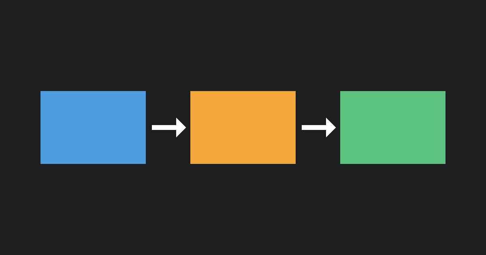

This site is a folder of Markdown files. A push to `main` builds it with Hugo
and publishes it to GitHub Pages. There is no server to patch and no CMS to
back up.

<!--more-->

## The pipeline



| Stage  | Tool                     | Output                                  |
| ------ | ------------------------ | --------------------------------------- |
| Source | Markdown + `hugo.toml`   | Content and configuration               |
| Build  | Hugo Extended + PaperMod | Static HTML, RSS, sitemap, search index |
| Deploy | `actions/deploy-pages`   | A versioned GitHub Pages deployment     |

Pull requests run the same build, plus Markdown linting and an internal
link check, but never deploy.

## Writing a post

Posts are page bundles: a folder with an `index.md` and any images it uses.

```bash
hugo new content posts/my-first-post/index.md
hugo server --buildDrafts
```

On Windows, the same commands work in PowerShell. To list drafts that still
need attention:

```powershell
Get-ChildItem -Path content/posts -Filter index.md -Recurse |
    Where-Object { (Get-Content $_.FullName -Raw) -match '(?m)^draft:\s*true' } |
    Select-Object -ExpandProperty DirectoryName
```

## The deploy job

The deploy job needs exactly two permissions beyond reading the
repository:

```yaml
permissions:
  contents: read
  pages: write
  id-token: write
```

`id-token: write` lets `actions/deploy-pages` prove which workflow run it
belongs to with OIDC, so no personal access token is stored anywhere.

## Further reading

The companion post on
[validating Terraform input]()
shows how code blocks for HCL, Go and JSON render on this site.
